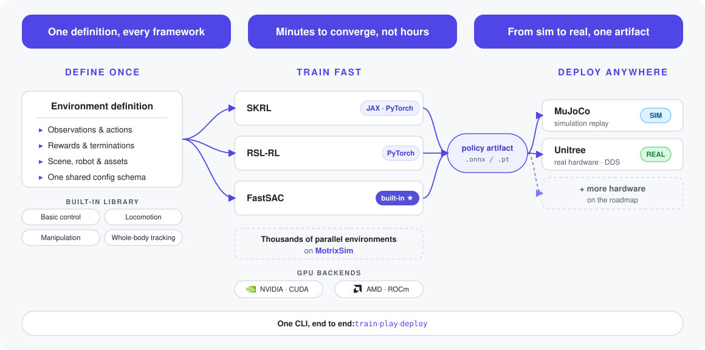

**语言**: [English](README.md) | [简体中文](README.zh-CN.md)

<div align="center">

# MotrixLab

[](LICENSE)

[](https://github.com/Motphys/MotrixLab/releases)
[](https://motrixlab.readthedocs.io)

**在仿真中训练机器人策略，并部署到真实硬件。**


_使用 MotrixLab 训练的 microduck 行走策略，由 MotrixRender 实时渲染 — [观看高清视频](https://github.com/user-attachments/assets/4bcf3122-f135-44cb-a966-d2d8e84479da)。_

**📖 用户文档**: [简体中文](https://motrixlab.readthedocs.io/zh-cn/stable/) | [English](https://motrixlab.readthedocs.io/en/stable/)

</div>

## 目录

- [MotrixLab 是什么？](#motrixlab-是什么)
- [主要特性](#主要特性)
- [快速开始](#-快速开始)
- [任务环境](#-任务环境)
- [Go2 平地直行第一版算法](#go2-平地直行第一版算法)
- [Go2 平地直行修改版](#go2-平地直行修改版)
- [Go2 平地步态消融与摆动约束](#go2-平地步态消融与摆动约束)
- [内置机器人模型](#-内置机器人模型)
- [项目组成](#-项目组成)
- [参与贡献](#-参与贡献)
- [联系方式](#-联系方式)

## MotrixLab 是什么？

**MotrixLab** 是一个开源的机器人强化学习训练框架，构建于高性能的 [MotrixSim](https://github.com/Motphys/motrixsim-docs) 物理引擎之上。环境只需定义一次，即可通过 SKRL、RSLRL 或内置的 FastSAC 使用数千个并行环境实例进行训练，训练得到的策略可部署到 MuJoCo、原生 MotrixSim 或 Unitree 硬件 —— 全程只需一个命令行接口。

<div align="center">
  <picture>
    <source media="(prefers-color-scheme: dark)" srcset="docs/source/_static/images/architecture-dark.svg">
    
  </picture>
</div>

## 主要特性

- **统一接口**: 提供简洁统一的强化学习训练和评估接口
- **多框架支持**: 支持 SKRL（JAX/PyTorch）、RSLRL（PyTorch）和内置 FastSAC 实现
- **丰富环境**: 包含基础控制、运动、操作等多种机器人仿真环境
- **Sim-to-Real 部署**: 同一套策略代码，通过部署 CLI 部署到 MuJoCo 或原生 MotrixSim 仿真，以及 Unitree Go2 真机
- **高精度高性能仿真**: 基于 [MotrixSim](https://motrixsim.readthedocs.io/) 高精度、高性能物理仿真引擎
- **可视化训练**: 支持实时渲染和训练过程可视化

## 🚀 快速开始

### 前置条件

| 要求 | 说明 |
| --- | --- |
| Python **3.10.x** | workspace 锁定 `==3.10.*` |
| [uv](https://docs.astral.sh/uv/) | Python 项目与依赖管理工具 — [安装指南](https://docs.astral.sh/uv/getting-started/installation/) |
| [Git LFS](https://git-lfs.com) | 机器人网格、运动数据与视频由 LFS 管理 |
| 操作系统 | Linux x86_64 或 Windows x86_64；JAX 训练后端仅支持 Linux |
| GPU | NVIDIA（CUDA）或 AMD（ROCm）——`sh install.sh` 自动选择对应 wheel |

### 1. 克隆仓库

```bash
git clone https://github.com/Motphys/MotrixLab
cd MotrixLab
git lfs pull
```

### 2. 安装依赖

Linux：

```bash
sh install.sh
```

Windows（PowerShell）：

```powershell
.\install.ps1
# 若提示执行策略受限：
powershell -ExecutionPolicy Bypass -File install.ps1
```

脚本会自动探测 GPU 厂商（NVIDIA → CUDA，AMD → ROCm），安装运行环境所需的 workspace package、对应的 PyTorch wheel、必需的 SKRL Torch 和内置 FastSAC。可用 `--gpu cuda|rocm` 显式指定 GPU；`--rslrl` 追加 RSL-RL，`--skrl-jax` 追加可选的 Linux-only SKRL JAX 后端。由于 SKRL Torch 已是必需依赖，`--skrl-torch` 仍作为兼容参数接受。参数可以组合；详见 `sh install.sh --help`。

### 3. 训练第一个策略

先激活安装好的环境（Windows PowerShell：`.venv\Scripts\Activate.ps1`）：

```bash
source .venv/bin/activate
python scripts/train.py task=microduck-walk-flat/motrix.fastsac play=true
```

训练过程中，内置面板会实时显示运行进度、回合统计、吞吐、奖励与系统健康状态：

<p align="center">
  
</p>

训练会启动数千个并行环境实例；训练结束后会自动加载策略并在查看器中回放。checkpoint 与 TensorBoard 日志保存在 `runs/microduck-walk-flat/` 目录下，通过以下命令查看训练曲线：

```bash
tensorboard --logdir runs/microduck-walk-flat
```

microduck 的训练数分钟内即可完成：平均回报与回合长度通常在约 4,000 次迭代后收敛：

<p align="center">
  
</p>

### 4. 回放训练好的策略

无需重新训练即可回放最近一次训练得到的策略（例如提前 Ctrl+C 中断训练之后）：

```bash
python scripts/play.py env=microduck-walk-flat
```

训练好的 microduck 策略在查看器中的回放效果：

https://github.com/user-attachments/assets/4bcf3122-f135-44cb-a966-d2d8e84479da

## 🌍 任务环境

MotrixLab 内置 50+ 个仿真环境，覆盖基础控制、四足、人形、全身动作跟踪、操作等类别。主要类别如下：

| 预览图 | 类别 | 示例环境 |
| --- | --- | --- |
|  | 四足速度跟踪 | `go2-walk-flat` · `go2-walk-rough` · `go1-walk-rough` · `anymalc-walk-flat` |
|  | 人形速度跟踪 | `g1-walk-flat` · `k1-walk-rough` · `dex-evt-walk-flat` · `microduck-walk-flat` |
|  | 全身动作跟踪（WBT） | `g1-wbt-dance` · `k1-wbt-freekick` · `g1-29dof-wbt-largebox` |

```bash
python scripts/view.py env=go2-walk-rough
```

完整环境列表与各环境支持的训练算法见[环境总览](https://motrixlab.readthedocs.io/zh-cn/latest/user_guide/envs/index.html)。

## Go2 平地直行第一版算法

第一版 `go2-walk-flat` 使用 MotrixSim、`QuadrupedWalkTask` 和 RSL-RL PPO。策略输出 12 维关节位置残差，经 `action_scale=0.25` 转换为关节目标角；Actor 使用 49 维观测，Critic 使用 Actor 观测加 3 维局部线速度的 52 维 value observation。

观测由角速度（3）、投影重力（3）、关节位置偏差（12）、关节速度（12）、上一动作（12）、速度命令（3）和四脚 trot 相位（4）组成。命令为 `[vx, vy, yaw]`，范围分别是 `[-1, 1]`、`[-0.5, 0.5]` 和 `[-0.5, 0.5]`；10% 概率采样零命令，5–10 秒重新采样一次。

奖励包括线速度/角速度跟踪、垂向速度、横滚俯仰角速度、机体高度、动作变化、默认姿态、足端摆动高度、接触相位和摆动期误触地。训练时启用关节/状态噪声、摩擦、质量、质心、PD 增益和 0–1 步动作延迟随机化。

算法和代码对应关系：

| 组件 | 文件 |
| --- | --- |
| Go2 平地任务配置与注册 | `motrix_envs/src/motrix_envs/locomotion/quadruped/go2.py` |
| 环境循环、观测、动作、相位和奖励 | `motrix_envs/src/motrix_envs/locomotion/quadruped/walk_np.py` |
| 命令、随机化和奖励配置结构 | `motrix_envs/src/motrix_envs/locomotion/quadruped/cfg.py` |
| 速度命令采样 | `motrix_envs/src/motrix_envs/locomotion/quadruped/velocity_command.py` |
| Go2 模型、关节顺序和默认姿态 | `motrix_robots/src/motrix_robots/unitree.py` |
| Go2 PPO 训练参数 | `configs/task/go2-walk-flat/rslrl.ppo.yaml`、`configs/algo_base/rslrl.ppo.yaml` |
| 训练入口和 RSL-RL provider | `scripts/train.py`、`motrix_rl_rslrl/src/motrix_rl_rslrl/torch/train/ppo.py` |
| 固定速度直行评估 | `scripts/play_walk.py`、`configs/play_walk.yaml` |
| Go2 部署 profile | `motrix_envs/src/motrix_envs/deploy/go2_walk.py` |

```bash
python scripts/train.py task=go2-walk-flat/rslrl.ppo
python scripts/play_walk.py env=go2-walk-flat policy=<checkpoint>
```

评估结果保存在运行目录的 `walk_analysis/velocity_metrics.json`。

## Go2 平地直行修改版

修改版通过 `quadruped/go2_walk.py` 注册为当前 `go2-walk-flat` 配置，并保留 49 维 Actor、52 维 Critic 和 12 维关节动作接口，便于继续使用原有 PPO 训练和部署链路。

相对第一版的主要变化：

- 命令采样增加单轴命令和边界命令覆盖：默认 `single_axis_probability=0.45`、`boundary_probability=0.15`，提高纯前进、纯侧向和极限速度在训练中的出现频率。
- 运动时关闭 `similar_to_default` 惩罚，避免默认姿态约束抑制摆腿。
- 增加平衡姿态、站立保持、支撑足滑移、关节加速度和动作二阶平滑奖励。
- 调整速度跟踪与稳定性奖励权重：线速度跟踪为 `2.0`，角速度跟踪为 `0.75`，并加强姿态、高度、动作和足端约束。
- 固定直行评估的 `for_play()` 配置为 `[vx, vy, yaw]=[0.5, 0, 0]`，关闭播放噪声和命令重采样。
- `play_walk.py` 每个控制步重新写入固定命令；schema v2 的紧凑跟踪字段明确使用 `[vx, vy, yaw_rate]`。垂向线速度 `vz` 不会被删除，保存在 `mean_linear_velocity[2]`、`linear_velocity_rmse[2]`，并提供 `vz_rms`、`vz_p95_abs`、`vz_std` 和 `vz_delta_rms`；yaw 则单独提供 `yaw_rate_rmse`、`yaw_rate_p95_error` 和 `yaw_rate_delta_rms`。

修改版新增或扩展的代码位置：

| 修改内容 | 文件 |
| --- | --- |
| 当前 Go2 改进配置、命令和奖励权重 | `motrix_envs/src/motrix_envs/locomotion/quadruped/go2_walk.py` |
| 命令采样的单轴/边界覆盖 | `motrix_envs/src/motrix_envs/locomotion/quadruped/velocity_command.py` |
| 新奖励项及动作/状态历史缓存 | `motrix_envs/src/motrix_envs/locomotion/quadruped/walk_np.py` |
| 新配置字段 | `motrix_envs/src/motrix_envs/locomotion/quadruped/cfg.py` |
| 固定命令评估和 JSON 指标 | `scripts/play_walk.py`、`configs/play_walk.yaml` |
| 算法映射记录 | `docs/go2_rl_gym_ppo_mapping.md` |

`play.py` 是通用回放入口，不会像 `play_walk.py` 一样在每个 step 强制写入直行命令。Go2 平地直行的速度指标应使用 `play_walk.py`，结果默认写入 `walk_analysis/velocity_metrics.json`。

### Go2 平地步态消融与摆动约束

平地步态迁移中的每组实验都使用独立环境名。旧 checkpoint 仍按原环境解释，需要回退时直接选择上一版本环境，无需覆盖代码或模型：

| 环境 | 相对上一组实验的变化 |
| --- | --- |
| `go2-walk-flat-d-legacy-pose` | 使用 legacy RL Gym 的 Go2 默认髋关节角：左侧 `+0.1`、右侧 `-0.1`。 |
| `go2-walk-flat-d-swing` | 增加后足摆动横向距离和横向速度约束。 |
| `go2-walk-flat-d-swing-v2` | 使用明确的距离与速度容差，对后足摆动惩罚进行归一化。 |
| `go2-walk-flat-d-swing-v3` | 保留 v2，并增加较弱的前足单边越界约束；正常范围内的前足摆动不受惩罚。 |

v3 的前足横向边界初始设为 `0.16 m`。只有摆动前足超过该边界时，才对横向距离和横向速度施加惩罚，避免把前足强行拉向固定目标。实现位于 `quadruped/go2_swing_ablation.py`，各版本 PPO 配置位于 `configs/task/go2-walk-flat-d-swing*/rslrl.ppo.yaml`。

固定命令评估现已同时输出前足和后足摆动的最大横向距离、P95 横向距离和峰值横向速度。比较不同 checkpoint 时，应保持命令、随机种子、预热时长和 `eval_steps` 完全一致：

```bash
python scripts/play_walk.py \
  env=go2-walk-flat-d-swing-v3 \
  policy=<checkpoint> \
  forward_velocity=0.5 lateral_velocity=0 yaw_velocity=0 \
  warmup_seconds=2 eval_steps=5760 \
  analysis_dir=runs/eval/go2_d_swing_v3
```

随机命令评估入口 `eval_walk_random.py` 按可配置的均匀分布采样 `[vx, vy, yaw]`，并使用独立的 `command_seed` 和固定命令切换间隔，便于复现实验：

```bash
python scripts/eval_walk_random.py \
  env=go2-walk-flat-d-swing-v3 \
  policy=<checkpoint> \
  num_envs=16 seed=1 rand_seed=false command_seed=1 \
  duration_seconds=120 warmup_seconds=2 command_interval_seconds=2 \
  analysis_dir=runs/eval/go2_d_swing_v3_random
```

baseline、v1、v2 和 v3 均可使用该随机评估入口，但 `env` 必须与 checkpoint 的训练环境对应。随机评估输出聚合后的速度跟踪和稳定性指标；四足摆动外翻仍应使用固定命令评估逐足分析。

当前仿真结果表明，v3 相比 v2 降低了前足横向摆动距离和峰值横向速度，并基本保留了后足改善；随机命令下的总体 `vx`、`vy` 跟踪优于 baseline，但 yaw 跟踪、姿态 RMS 和机身高度波动仍存在取舍。纯前进命令下允许出现小幅周期性 `vy` 和 yaw，但长时间均值应接近零。以上均为仿真结论，不能视为真实机器人已经可用；实机验证仍是后续独立阶段。

## 🤖 内置机器人模型

通过 robot registry 内置 7 个可复用机器人模型，可与任意场景和任务组合：

| 截图 | Registry 名称 | 类型 | 自由度 |
| --- | --- | --- | --- |
|  | `anymal_c` | 四足机器人 | 12 |
|  | `dex-evt` | 人形机器人 | 23 |
|  | `g1-29dof` | 人形机器人 | 29 |
|  | `go1` | 四足机器人 | 12 |
|  | `go2` | 四足机器人 | 12 |
|  | `k1` | 人形机器人 | 22 |
|  | `microduck` | 人形机器人 | 14 |

```bash
python scripts/view.py robot=go2
```

通过公共配置 API 直接构造模型，用于场景组合：

```python
from motrix_robots import Microduck, UnitreeGo2Robot

microduck = Microduck()
go2 = UnitreeGo2Robot()
```

机器人配置细节与自定义新模型的方法见[支持的机器人](https://motrixlab.readthedocs.io/zh-cn/latest/user_guide/robots.html)。

## 🏗️ 项目组成

MotrixLab 是一个 [uv](https://docs.astral.sh/uv/) workspace，包含以下 package：

| Package | PyPI 名称 | 说明 |
| --- | --- | --- |
| **motrix_deploy** | `motrix-deploy` | artifact、控制会话、运行时契约与部署 CLI |
| **motrix_deploy_mujoco** | `motrix-deploy-mujoco` | MuJoCo 部署 backend plugin |
| **motrix_deploy_motrixsim** | `motrix-deploy-motrixsim` | 原生 MotrixSim 部署 backend plugin |
| **motrix_deploy_unitree** | `motrix-deploy-unitree` | 独立于资产的 Unitree 硬件配置、sensor/actuation 接线与 SDK2 DDS backend plugin |
| **motrix_deploy_tasks** | `motrix-deploy-tasks` | 行走任务、部署场景与安装的 Hydra 配方 |
| **motrix_env_core** | `motrix-env-core` | backend 无关的环境框架、配置、registry 与渲染 |
| **motrix_env_motrixsim** | `motrix-env-motrixsim` | MotrixSim 实时仿真 backend、renderer 与 Torch frontend |
| **motrix_env_mujoco** | `motrix-env-mujoco` | 仅负责编译场景的 MuJoCo backend |
| **motrix_robots** | `motrix-robots` | 可复用机器人配置、默认姿态与模型资产 |
| **motrix_envs** | `motrix-envs` | 内置环境、任务资产、数据及部署 profile 编译实现 |
| **motrix_rl** | `motrix-rl` | RL 控制平面、provider/trainer contract、run/checkpoint 管理与 discovery |
| **motrix_rl_builtin** | `motrix-rl-builtin` | 内置 Motrix FastSAC provider |
| **motrix_rl_skrl** | `motrix-rl-skrl` | 必需的 SKRL PPO Torch provider；可选 JAX extra |
| **motrix_rl_rslrl** | `motrix-rl-rslrl` | 可选的 RSL-RL PPO Torch provider |

## 🤝 参与贡献

欢迎参与贡献！开发环境搭建、分支与提交规范、以及仓库配置的检查工具（`prek`、`ruff`、`dprint`、`mypy`）请参见 [CONTRIBUTING.md](CONTRIBUTING.md)。

## 📬 联系方式

有问题或建议？欢迎通过以下方式联系我们：

- GitHub Issues: [提交问题](https://github.com/Motphys/MotrixLab/issues)
- Discussions: [加入讨论](https://github.com/Motphys/MotrixLab/discussions)

## 项目规范

- [贡献指南](CONTRIBUTING.md)
- [安全策略](SECURITY.md)
- [行为准则](CODE_OF_CONDUCT.md)
- [支持与提问](SUPPORT.md)
- [第三方声明](THIRD_PARTY_NOTICES.md)
- [更新日志](CHANGELOG.md)
- [引用信息](CITATION.cff)
- [许可证](LICENSE)
